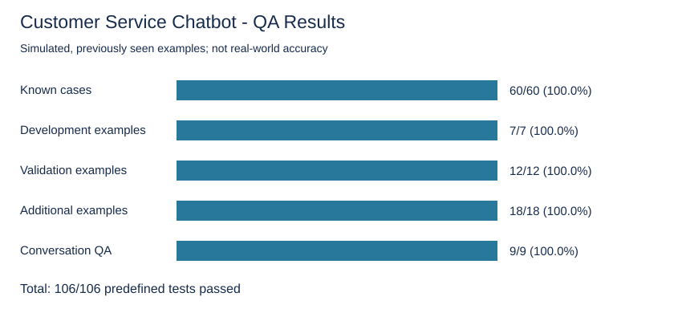

# Customer Service Intent Classifier & Chatbot

## About the Project

I built this project to practise Python and explore how a customer service chatbot can identify different types of enquiries.

My experience in customer service helped me come up with realistic scenarios, while my IT background gave me a starting point for developing the code. I also used ChatGPT to help me learn Python, troubleshoot errors and improve the project.

This is a personal learning project using fictional customer messages. It is not connected to any employer or real customer system.

## What the Chatbot Does

The chatbot uses simple Python rules to recognise customer enquiries across six main categories:

- App Login
- Duplicate Email
- Online Orders
- Billing
- Network Issues
- Fallback (when an enquiry is not recognised)

It also supports clarification when a customer mentions an unclear charging issue, switching between topics, and cancelling or restarting a conversation.

The project includes automated tests and a dashboard to track the results.

## How to Run It

The project uses Python 3.10+ and does not require additional libraries for the main scripts.

Download the project, open a terminal in the project folder and run:

```bash
python intent_classifier.py
python test_chatbot.py
python run_qa.py
```

To run the additional engineering checks:

```bash
python test_review.py
```

You can also try a short conversation in Python:

```python
import chatbot

print(chatbot.chat("I have a charge issue"))
print(chatbot.chat("2"))
print(chatbot.chat("cancel"))
```

The `Customer_Service_Chatbot_Development.ipynb` notebook provides a walkthrough of the project. It can be opened using Jupyter or Google Colab, with the project files available in the working directory.

## Testing and Improvements

I started by testing the classifier against a collection of simulated customer messages. Some messages were classified incorrectly because customers can describe the same problem in different ways.

I reviewed the failed cases, updated the keyword rules and ran the tests again. I kept the original expected answers unchanged.

| Test Set | Before | After |
|---|---:|---:|
| Original classification cases | 60/60 | 60/60 |
| Development examples | 2/7 | 7/7 |
| Validation examples | 9/12 | 12/12 |
| Additional examples | 11/18 | 18/18 |
| Conversation tests | 9/9 | 9/9 |
| **Total** | **91/106** | **106/106** |

The final review also passed seven additional engineering checks covering conversation behaviour, input validation and error handling.

These results are based on predefined tests, including examples used during development. They show that the current code passes those tests, not that the chatbot will correctly understand every new customer message.



## What I Learned

Working on this project helped me understand:

- How a rule-based intent classifier works.
- How keyword matching and rule priority affect classification.
- How to manage basic conversation states and clarification questions.
- How to use automated tests to identify and fix problems.
- Why passing known tests does not guarantee good results on new inputs.

I also gained more confidence using Python, debugging code and working with CSV files.

## Limitations and Next Steps

This is a rule-based chatbot, not a machine learning model or an LLM.

It works best with familiar wording and may struggle with unexpected phrases, multiple questions in one message or enquiries that need more context.

For example, **"I cannot make calls at home"** currently returns `Fallback`, even though it could indicate a network issue.

If I continue developing the project, I would like to test it with more unseen examples, improve how it handles different wording and eventually compare it with a simple machine learning approach.

## Project Files

| File | Purpose |
|---|---|
| `intent_classifier.py` | Classifies customer messages |
| `chatbot.py` | Handles responses and conversation flow |
| `run_qa.py` | Runs the main automated tests |
| `test_chatbot.py` | Tests conversation scenarios |
| `test_review.py` | Runs additional engineering checks |
| `test_cases.csv` | Original classification test cases |
| `development_cases.csv`, `validation_cases.csv`, `additional_cases.csv` | Additional classification examples |
| `*_results.csv` | Saved test results |
| `qa_dashboard.svg` | Visual summary of QA results |
| `Customer_Service_Chatbot_Development.ipynb` | Development walkthrough |
| `edge_case_summary.md` | Notes on challenging test cases |
| `REVIEW_REPORT.md` | Detailed project review |
| `execution_results.json` | Results recorded during final review |

---

*Developed as a personal learning portfolio with ChatGPT assistance. All customer examples are simulated.*
